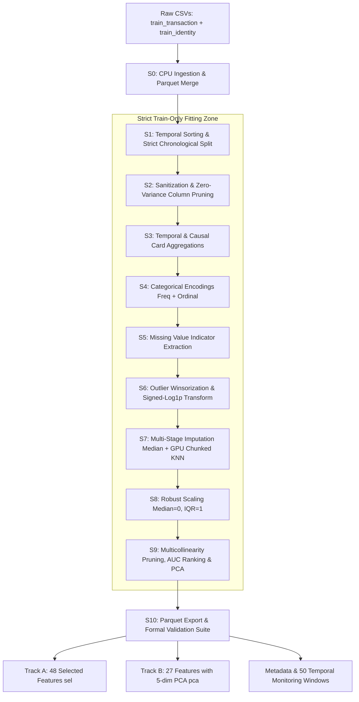

# FEDBANK Preprocessing Architecture & Deep Pipeline Specification

> **Audience**: AI Engineering Agent / Evaluator  
> **Objective**: Comprehensive architectural review and validation blueprint of the IEEE-CIS Fraud Detection preprocessing & feature engineering pipeline.  
> **Hardware Profile**: NVIDIA GeForce RTX 4050 Laptop (6.00 GiB VRAM), WSL2 Ubuntu, Python 3.11, RAPIDS (cuDF, cuML, cuPy, RMM).  
> **Notice**: Local documentation file — not committed to Git repository.

---

## 1. High-Level Architecture Hierarchy

The FEDBANK pipeline transforms 590,540 raw, messy, anonymized transactions into clean, normalized, model-ready feature matrices for Graph Neural Networks (GNNs).



---

## 2. Rationale: Why This Exact Hierarchical Order Matters

Every stage is deliberately sequenced to satisfy fundamental machine learning integrity constraints and GPU memory limitations:

```
[S1: Split First] ──> [S2: Clean] ──> [S3: Engineer] ──> [S4: Encode] ──> [S5: Missing Flags]
         │
         ▼
[S6: Winsorize & Skew BEFORE Impute] ──> [S7: Impute] ──> [S8: Scale] ──> [S9: Reduce] ──> [S10: Export]
```

1. **Split First (S1 Before Everything)**:
   * **Rule**: Zero data leakage.
   * If scalers, missing rates, vocabularies, or quantiles were calculated over the whole dataset, future test/validation distribution information would leak into the training features. Splitting in S1 guarantees that all downstream parameters are learned exclusively from the first 273,000 training rows.

2. **Causal Time Constraints (S3 Before Encodings)**:
   * Features such as `card_velocity` and `card_prior_txn_count` aggregate past behavior. They must use strictly preceding rows (`cumcount()` over time) to ensure zero forward-looking bias.

3. **Missing Flags Extracted Before Imputation (S5 Before S7)**:
   * The fact that an attribute (e.g. `addr1` or `D12`) was missing is itself an informative predictor in fraud detection. Missing indicators must be extracted **before** NaNs are filled with medians or KNN predictions.

4. **Winsorization & Skew Transform BEFORE KNN Imputation (S6 Before S7)**:
   * *Critical Architectural Decision*: The research paper by Menezes & Filho notes that heavy-tailed financial distributions ruin distance-based algorithms.
   * KNN relies on Euclidean distance in feature space:
     $$d(\mathbf{x}, \mathbf{y}) = \sqrt{\sum_{i=1}^d (x_i - y_i)^2}$$
   * If extreme outliers ($10^{30}$ or $\$100,000$ transactions) exist during KNN, a single feature dominates the entire Euclidean distance, destroying nearest neighbor quality. Therefore, **clipping percentiles $[1\%, 99\%]$ and applying log transforms in S6 prior to S7 ensures well-conditioned distance metrics**.

5. **Scaling (S8) Before Reduction & PCA (S9)**:
   * Correlation pruning, univariate ranking, and PCA require features to be completely imputed (zero NaNs) and centered on a uniform scale ($\text{IQR} = 1$).

---

## 3. Comprehensive Stage-by-Stage Technical Deep Dive

### Stage S0 — CPU Ingestion & Parquet Unification
* **Source Module**: `scripts/preprocess/io_utils.py`
* **Input**: `train_transaction.csv` (590,540 $\times$ 394), `train_identity.csv` (144,233 $\times$ 41).
* **Output**: `data/interim/raw_merged.parquet` (590,540 $\times$ 434).
* **Processing Mechanics**:
  * Identity column normalization: Maps hyphenated keys (`id-01`) to underscore (`id_01`).
  * Upfront memory typing: Identifiers $\to$ `int32`/`int64`, targets $\to$ `int8`, known categoricals $\to$ `str`, numerics $\to$ `float32`.
  * Left join on `TransactionID` to retain all transaction records.

---

### Stage S1 — Chronological Ordering & Split Allocation
* **Source Module**: `scripts/preprocess/s1_split.py`
* **Input**: `raw_merged.parquet`
* **Output**: `data/interim/meta.parquet`, `data/interim/after_s1.parquet`, `artifacts/preprocess_state.json`.
* **Processing Mechanics**:
  * Sorts transactions strictly by `TransactionDT` ascending, with `TransactionID` as tie-breaker.
  * Partitions rows based on Menezes & Filho (IEEE Access 2025) Table 1:
    * **Train (`split = 0`)**: Rows `0` to `272,999` (273,000 rows; fraud rate: **3.33%**)
    * **Val (`split = 1`)**: Rows `273,000` to `331,499` (58,500 rows; fraud rate: **3.62%**)
    * **Test (`split = 2`)**: Rows `331,500` to `389,999` (58,500 rows; fraud rate: **3.70%**)
    * **Monitor (`split = 3`)**: Rows `390,000` to `590,539` (200,540 rows; fraud rate: **3.64%**)
  * Indexes the monitoring split into **50 sequential daily evaluation windows** of 3,000 rows each (`row_in_monitor // 3000`).

---

### Stage S2 — Data Sanitization & Noise Elimination
* **Source Module**: `scripts/preprocess/s2_clean.py`
* **Input**: `after_s1.parquet`
* **Output**: `after_s2.parquet`
* **Processing Mechanics**:
  * Replaces $\pm\infty$ with null across all 388 numeric float columns.
  * Pruning (computed exclusively on train set):
    1. **High Missingness (>90%)**: Drops 4 columns (`dist2`, `id_07`, `id_08`, `id_21`).
    2. **Constant**: Drops columns with $\le 1$ unique value (1 column dropped).
    3. **Near-Constant**: Drops columns where top modal value occupies $\ge 99.5\%$ of all non-null values (11 columns dropped).
  * Surviving column count: **420 columns**.

---

### Stage S3 — Feature Engineering & Causal Card Aggregation
* **Source Module**: `scripts/preprocess/s3_engineer.py`
* **Input**: `after_s2.parquet`
* **Output**: `after_s3.parquet`
* **Processing Mechanics**:
  * **Temporal Extraction**:
    * `transaction_day = TransactionDT // 86400`
    * `transaction_hour = (TransactionDT // 3600) % 24`
    * `transaction_dow = (TransactionDT // 86400) % 7`
  * **Amount Transformations**:
    * `TransactionAmt_log = log1p(TransactionAmt)`
    * `amt_cents = (TransactionAmt * 1000) % 1000`
    * `amt_is_round = (TransactionAmt % 1 == 0).astype(int8)`
  * **Causal Card UID**:
    $$\text{card\_key} = \text{card1}\_\text{card2}\_\text{card3}\_\text{card5}\_\text{addr1}\_(\text{day} - \text{D1})$$
    *Note*: In IEEE-CIS, $\text{day} - \text{D1}$ approximates the original card creation date.
  * **Causal Behavioral Features**:
    * `card_prior_txn_count`: Sequential cumulative count within card key up to transaction $t$. First instance is strictly $0.0$.
    * `card_is_first_seen`: $1$ if `prior_count == 0` else $0$.
    * `card_time_since_last`: $\log(1 + (\text{DT}_t - \text{DT}_{t-1}))$, $-1.0$ if first seen.
    * `card_velocity`: $\frac{\text{prior\_count}}{\Delta \text{days} + 1}$.
    * `amt_to_avg_card_ratio`: Ratio of current transaction amount to historical mean for that card.
    * `email_match`: Binary flag indicating if purchaser domain matches recipient domain (`P_email == R_email`).

---

### Stage S4 — Categorical Encoding
* **Source Module**: `scripts/preprocess/s4_encode.py`
* **Input**: `after_s3.parquet`
* **Output**: `after_s4.parquet`, `artifacts/encoders.json`, `artifacts/encoders_counts.npz`
* **Processing Mechanics**:
  * **Frequency Encoding (High Cardinality)**:
    * Features: `card1`, `card2`, `addr1`, `addr2`, `card_key_id`, `card1_addr1_hash`.
    * Calculation: $\text{freq}(c) = \frac{\text{count}(c)}{N_{\text{train}}}$. Unseen categories in test/val receive $0.0$.
  * **Ordinal Encoding (Low Cardinality)**:
    * Features: `ProductCD`, `card4`, `card6`, `M1`–`M9`, `DeviceType`, `id_12`–`id_38`.
    * Mapped to categorical codes $0 \dots C-1$. Nulls and unseen values mapped to $-1$.
  * Raw free-text strings (`P_emaildomain`, `R_emaildomain`, `DeviceInfo`) dropped.

---

### Stage S5 — Missing Indicator Flags
* **Source Module**: `scripts/preprocess/s5_missing_flags.py`
* **Input**: `after_s4.parquet`
* **Output**: `after_s5.parquet`
* **Processing Mechanics**:
  * Scans train set for columns with missing rate $> 5\%$.
  * Extracts boolean indicator arrays: $\text{missing\_flag} = \text{isna}(x)$.
  * Computes binary hash signatures across rows to detect perfectly collinear patterns (e.g. features always missing together).
  * Deduplicates co-occurring patterns: 315 eligible flags reduced to **30 independent indicator columns**.

---

### Stage S6 — Winsorization & Skew Normalization
* **Source Module**: `scripts/preprocess/s6_winsor_skew.py`
* **Input**: `after_s5.parquet`
* **Output**: `after_s6.parquet`
* **Processing Mechanics**:
  * Winsorizes 431 continuous columns against train percentiles:
    $$x \leftarrow \text{clip}(x, q_{0.01}^{\text{train}}, q_{0.99}^{\text{train}})$$
  * Evaluates Fisher-Pearson skewness:
    $$\gamma = \frac{\mathbb{E}[(x - \mu)^3]}{\sigma^3}$$
  * For $|\gamma| > 2.0$:
    * Non-negative distributions (289 cols): $x \leftarrow \log(1 + x)$.
    * Negative distributions (4 cols): $x \leftarrow \text{sign}(x) \cdot \log(1 + |x|)$.

---

### Stage S7 — Hybrid Numerical Imputation
* **Source Module**: `scripts/preprocess/s7_impute.py`
* **Input**: `after_s6.parquet`
* **Output**: `after_s7.parquet`
* **Processing Mechanics**:
  * Categorizes features based on train missing rate $M$:
    1. $M = 0\%$: 68 columns $\to$ No-op.
    2. $0\% < M < 50\%$: 138 columns $\to$ **GPU KNN Imputation**.
    3. $M \ge 50\%$: 225 columns $\to$ **Median Imputation**.
  * **GPU Chunked Brute-Force KNN ($k=5$)**:
    * Builds dense anchor space from 19 complete columns (`TransactionAmt_log`, `transaction_hour`, `card1_freq`, `addr1_freq`, `card_velocity`, `C1`–`C14`).
    * Reference bank: 50,000 randomly selected train instances.
    * Model: `cuml.neighbors.NearestNeighbors(n_neighbors=5, algorithm='brute', metric='euclidean')`.
    * Imputes target columns in blocks of 64 features via GPU tensor gather:
      $$\hat{x}_{i, c} = \frac{1}{k}\sum_{j \in \mathcal{N}(i)} x_{j, c}$$
    * Fallback to train median if all neighbors are NaN.

---

### Stage S8 — Robust Scaling
* **Source Module**: `scripts/preprocess/s8_scale.py`
* **Input**: `after_s7.parquet`
* **Output**: `after_s8.parquet`, `artifacts/scaler.json`
* **Processing Mechanics**:
  * Normalizes 401 continuous features using train statistics:
    $$z = \frac{x - \text{median}_{\text{train}}}{q_{0.75}^{\text{train}} - q_{0.25}^{\text{train}}}$$
  * Invariant: Train feature medians $= 0.0 \pm 0.01$; immune to remaining heavy outliers.

---

### Stage S9 — Dimensionality Reduction & Drift Screening
* **Source Module**: `scripts/preprocess/s9_reduce.py`
* **Input**: `after_s8.parquet`
* **Output**: `after_s9.parquet`, `artifacts/pca_V.npz`
* **Processing Mechanics**:
  1. **Hard Prune**: Drops proxy/leakage columns (`TransactionDT`, `month`, `year`, `card_key_id`: 21 dropped).
  2. **Collinearity Pruning**:
     * Computes correlation matrix $R$ on GPU.
     * Evaluates pairs with $|r_{ij}| \ge 0.95$.
     * Tie-breaker: Retains feature with higher univariate ROC-AUC (Mann-Whitney $U$ test against `isFraud`). Drops the redundant feature (142 dropped, 306 retained).
  3. **Feature Selection (Track A)**:
     * Selects Top 48 features by ROC-AUC while preserving domain anchors (`card_velocity`, `amt_to_avg_card_ratio`, `email_match`).
  4. **Population Stability Index (PSI)**:
     * Assesses drift across chronological split boundary (Train $\to$ Val):
       $$\text{PSI} = \sum_{b=1}^{10} (P_b - Q_b) \ln\left(\frac{P_b}{Q_b}\right)$$
     * All chosen features pass stability threshold ($\text{PSI} < 0.25$).
  5. **PCA Track (Track B)**:
     * Fits `cuml.decomposition.PCA(n_components=5)` on 200 V-features, explaining 95% variance.
     * Combines 22 core non-V features + 5 orthogonal V-components $\to$ **27 total features**.

---

### Stage S10 — Parquet Export & Metadata Isolation
* **Source Module**: `scripts/preprocess/s10_export.py`
* **Input**: `after_s9.parquet`
* **Output**: Files in `data/processed/`, `artifacts/feature_manifest.json`, `reports/preprocess_report.md`.
* **Processing Mechanics**:
  * Casts all feature arrays strictly to `float32` (optimizing memory for downstream PyG tensors).
  * Exports separate feature and meta partitions for `train`, `val`, `test`, `monitor`.

---

## 4. Hardware Optimization & VRAM Management Architecture

Running RAPIDS on a **6.00 GiB RTX 4050 (WSL2)** required custom memory controls (`scripts/preprocess/gpu_env.py`):

1. **RMM Non-Pool Allocation**:
   * Initialized with `rmm.reinitialize(pool_allocator=False, managed_memory=False)`.
   * Avoids Unified Memory page faults inside WSL2 virtual machine layers.
2. **KvikIO Virtualization Bypass**:
   * WSL2 virtualized GPU direct POSIX I/O causes `CUDA_ERROR_ILLEGAL_ADDRESS`.
   * Solved by routing all Parquet serialization safely through PyArrow host memory buffers in `_safe_to_parquet`.
3. **Explicit Memory Eviction**:
   * Mandatory `cp.get_default_memory_pool().free_all_blocks()` and `gc.collect()` between stages.
   * Peak VRAM usage was held at **4.63 GiB / 6.00 GiB**, leaving 1.37 GiB headroom.

---

## 5. Verification Commands for the Reviewing Agent

Run these three commands to independently audit and verify the entire pipeline:

```bash
# 1. Activate conda environment
conda activate fedbank

# 2. Run unit test suite (validates encoding, causality cumcount, KNN, and PSI)
python -m scripts.preprocess.test_helpers
# Expected: "All unit tests passed ✓"

# 3. Run full verification assertions across all exported datasets
python -m scripts.preprocess.validate
# Expected: "ALL VALIDATIONS PASSED"
```

### Formal Verification Invariants Checked:
* **[V1] Row Count**: Exactly 590,540 rows.
* **[V2] Time Order**: $\max(\text{DT}_i) \le \min(\text{DT}_{i+1})$; sizes: 273,000 / 58,500 / 58,500 / 200,540.
* **[V3] Dtypes**: Zero object/string columns; 100% `float32`.
* **[V4] Nulls/Infs**: 0 nulls, 0 NaNs, 0 infs across all 8 feature files.
* **[V5] Schema**: Identical column names and sequence across all 4 splits.
* **[V6] Zero Leakage**: Train feature medians $= 0.0 \pm 0.01$.
* **[V7] Causality**: Within-card transactions strictly time-monotonic.
* **[V8] Collinearity**: Pairwise $|r| < 0.95$ in Track A.
* **[V9] VRAM**: Peak memory consumption stayed within 6.00 GiB hardware ceiling.
